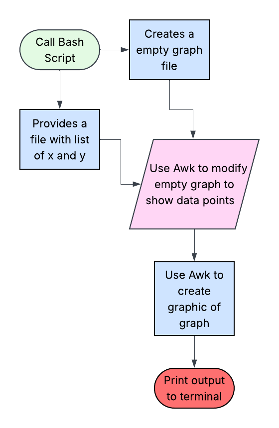

# Terminal_Graphing

Creates rough graph of basic functions in terminal. 

## The Problem

It's often inconvenient to switch between programs while working. Imagine you need to graph something while working in terminal, it would feel clunky to switch to another program.

## How It Works

This program takes a file containing a list of x and y and creates a graph from it. It does this by using awk to modify an empty text-based graph to show the datapoints. Awk is used again to create the graphical graph, and the result is printed to the terminal. 



## Tech Stack

- **Language:** Bash / Awk
- **Libraries:** None
- **External tools:** None

## Setup

1. Clone the repo
2. run './graph <file>'

```bash
git clone https://github.com/you/your-project
cd your-project
./graph <file> 
```

## Usage

```bash
*Creates linear graph
./graph <file_linear>
```

## Roadmap


- [ ] Allow creation of graph from function
- [ ] Ability to scale graph to differnt size

## Author

Jack Zheng, [GitHub.](https://github.com/JackZ-1)
