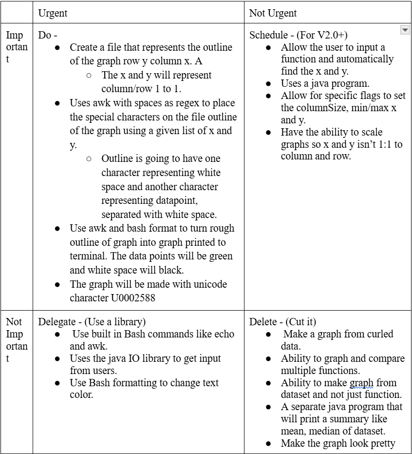

# Terminal_Graphing

Creates rough graph of basic functions in terminal. 

## The Problem

It's often inconvenient to switch between programs while working. Imagine you need to graph something while working in terminal, it would feel clunky to switch to another program.

## How It Works

This program takes a file containing a list of x and y and creates a graph from it. It does this by using awk to modify an empty text-based graph to show the datapoints. Awk is used again to create the graphical graph, and the result is printed to the terminal. 


## MVP Scope
1. Create a file that represents the outline of the graph with row y and column x. A The x and y will represent        column/row 1 to 1. 
2. Uses awk with spaces as regex to place the special characters on the file outline of the graph using a given        list of x and y. 
3. Outline is going to have one character representing white space and another character representing a datapoint 
4. Use awk and bash format to turn outline of graph into graph printed to terminal. The data points will be green      and white space will be black. The graph will be made with Unicode character U0002588

## Tech Stack

- **Language:** Bash / Awk
- **Libraries:** None
- **External tools:** None

## Setup

1. Clone the repo
2. run './graph <file>'

```bash
git clone https://github.com/you/your-project
cd your-project
./graph <file> 
```

## Usage

```bash
#Creates linear graph
./graph <file_linear>
```

## Roadmap


- [ ] Allow creation of graph from function
- [ ] Ability to scale graph to differnt size


## Author

Jack Zheng, [GitHub.](https://github.com/JackZ-1)
